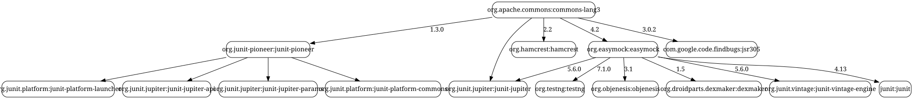
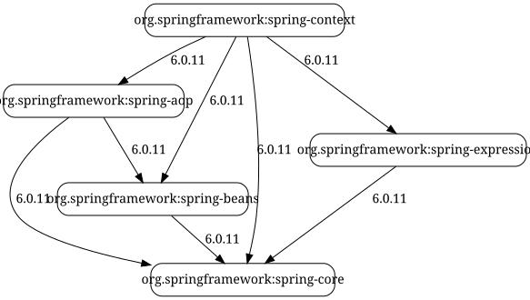
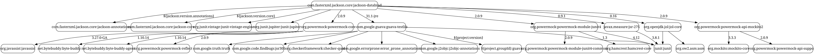

# Инструмент визуализации графа зависимостей (Maven)

CLI-приложение на языке Python для анализа и визуализации транзитивных зависимостей пакетов формата Maven без использования сторонних библиотек и менеджеров пакетов.

## Структура проекта
- `src/main.py` — основной модуль приложения (чтение конфигурации, сбор данных, построение графа, визуализация).
- `tests/test_graph.py` — модульные тесты на базе стандартной библиотеки `unittest`.
- `docs/` — демонстрационные скриншоты работы приложения на трёх различных пакетах.
- `config.json` — файл конфигурации параметров запуска.
- `test_repo.txt` — файл локального тестового репозитория для отладки и проверки сложных графов.
- `run.bat` — скрипт запуска приложения в операционной системе Windows.

## Настройки конфигурации (`config.json`)
- `package_name` (`str`) — имя анализируемого пакета в формате `groupId:artifactId` (или латинская буква в тестовом режиме).
- `repo_url` (`str`) — URL-адрес удаленного репозитория Maven или путь к файлу тестового репозитория.
- `test_mode` (`bool`) — режим работы с локальным тестовым репозиторием (`true` — локальный файл, `false` — удаленный репозиторий).
- `package_version` (`str`) — версия анализируемого пакета.
- `ascii_tree_mode` (`bool`) — включение вывода зависимостей в консоль в виде ASCII-дерева.
- `max_depth` (`int`) — максимальная глубина анализа транзитивных зависимостей (неотрицательное целое число).
- `filter_substring` (`str`) — подстрока для исключения пакетов из анализа (пустая строка отключает фильтрацию).

## Описание основных функций (`src/main.py`)
- `load_config` / `validate_config` — загрузка JSON-конфигурации и валидация типов и значений параметров.
- `build_pom_url` / `fetch_pom_xml` — формирование ссылки на `.pom`-файл в репозитории Maven и его загрузка по HTTP.
- `parse_maven_dependencies` — парсинг XML-структуры POM-файла и разрешение переменных версий из блока `<properties>`.
- `load_test_repository` — загрузка графа зависимостей из локального текстового файла.
- `build_dependency_graph` — построение ориентированного графа зависимостей методом нерекурсивного обхода в глубину (DFS) с учетом максимальной глубины, фильтрации и циклов.
- `generate_graphviz_dot` / `render_graphviz_image` — генерация текстового представления графа на языке Graphviz DOT и сохранение/открытие PNG-изображения.
- `print_ascii_tree` — форматированный вывод зависимостей в консоль в виде псевдографического дерева.

## Запуск и тестирование
Запуск приложения через скрипт:
```bat
run.bat
```

Запуск приложения напрямую через Python:
```bash
python src/main.py
```

Запуск модульных тестов:
```bash
python -m unittest discover -s tests -v
```

## Сравнение со штатным инструментом Maven
При сравнении вывода с командой `mvn dependency:tree` возможны следующие расхождения:
1. Штатный `mvn dependency:tree` строит дерево с разрешением конфликтов версий (отбрасывает дублирующиеся и более глубокие версии одного артефакта), тогда как данная утилита строит ориентированный граф всех встреченных связей до глубины `max_depth`.
2. Maven по умолчанию фильтрует зависимости по областям видимости (`<scope>` — например, исключает транзитивные `test`-зависимости), а утилита учитывает все записи `<dependency>` и применяет пользовательский фильтр `filter_substring`.
3. Прототип не загружает родительские POM-файлы (`<parent>`) и блоки `<dependencyManagement>`, поэтому зависимости с версиями из родительских конфигураций не раскрываются вглубь.

## Примеры работы:

### Пример 1. Пакет `org.apache.commons:commons-lang3` (версия `3.12.0`)


### Пример 2. Пакет `org.springframework:spring-context` (версия `6.0.11`)


### Пример 3. Пакет `com.fasterxml.jackson.core:jackson-databind` (версия `2.15.2`)

